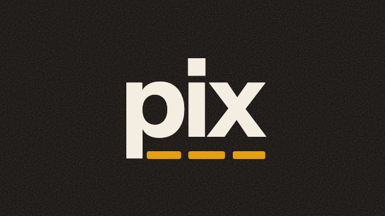
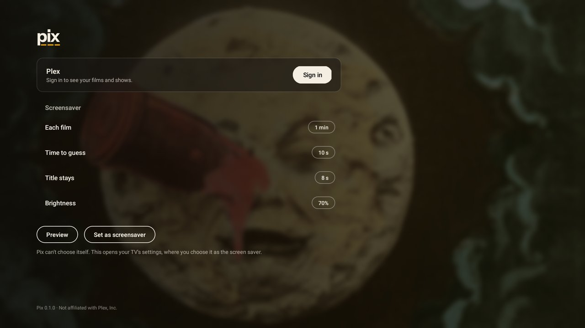

<p align="center"></p>

<p align="center"><strong>Pix: Screensaver for Plex on Android TV, the NVIDIA Shield and Google TV.</strong><br>Your Plex library as a slow, cinematic screensaver, with a guessing game.</p>

<p align="center"><a href="../../releases/latest"><strong>Download</strong></a> · <a href="https://work.betta.io/apps/pix/">Website</a> · <a href="#install">Install</a> · <a href="#google-tv">Google TV</a></p>

<p align="center"></p>

Pix takes the backdrops from the films and shows on your own Plex server and gives them a film look: grain, a
soft halation round the highlights, a little warmth. Then it pans slowly across them, one film a minute. While each
one is on screen it plays a small guessing game: halfway through you get the year, and a line under it shows how long
each word of the title is. Then the title appears.

<table><tr>
<td><br><sub>The still</sub></td>
<td><br><sub>The clue</sub></td>
<td><br><sub>The title</sub></td>
</tr></table>

## What it does

- **Your own library.** Films and TV shows from the Plex server you own, the better-rated ones and the ones you've
  seen coming up more often, since those are the ones you can guess. Pix leaves out any library with "private" in
  its name.
- **A film look, not a slideshow.** Each backdrop is developed once on the GPU, with grain fixed to the picture like a
  print, and then only panned. Stills with black bars are skipped.
- **The guessing game.** The year comes halfway, then the title. You choose how long each film stays, how long you
  get to guess and how long the title stays.
- **Works offline.** Pix keeps the last 40 films it showed, so it still has your films when the server is down.
- **Leaves your TV alone.** No wake locks, no sound, no video. Your TV's own sleep timer still ends the screensaver
  and turns the TV off.

In the screensaver, left and right change the film, up and down set the brightness, and OK opens the film in the
Plex app. Any other button closes it.

## What you need

- An Android TV device on Android 11 or later, such as an NVIDIA Shield.
- A Plex server you own, and the Plex account it's signed in to.

> [!IMPORTANT]
> **Google TV doesn't let you choose Pix for Plex in its settings.** That covers Chromecast with Google TV, the Google TV
> Streamer and most TVs sold since about 2022. Google TV only lists its own screensavers, so on those you set Pix
> from a computer with `adb` ([see below](#google-tv)). The Shield and other Android TV devices list Pix in their
> settings like any other screensaver.

## Install

1. Download `pix-<version>.apk` from the [latest release](../../releases/latest).
2. Put it on your TV. Either:
   - with the [Downloader](https://www.aftvnews.com/downloader/) app: enter the APK's link and allow Downloader to
     install apps when it asks; or
   - from a computer, with your TV's developer options and network debugging turned on:
     ```bash
     adb connect <your-tv's-ip>
     adb install pix-<version>.apk
     ```
3. Open **Pix** from your apps and scan the QR code with your phone. Approve it on Plex's page and you're signed in.
4. Choose Pix as your screensaver. In your TV's **Settings**, go to **Device Preferences → Screen saver → Screen
   saver** and pick **Pix for Plex**. *Set as screensaver* in Pix opens Settings for you.

Not signed in yet? The screensaver shows a public-domain still (the moon from Méliès's *A Trip to the Moon*, 1902)
with the QR code in a corner. Scan it from the sofa and your films take over.

### Google TV

With developer options and network debugging on (Settings → System → About, then select *Android TV OS build* seven
times):

```bash
adb connect <your-tv's-ip>
adb install pix-<version>.apk

# Note what's chosen now, so you can put it back later
adb shell settings get secure screensaver_components

# Choose Pix
adb shell settings put secure screensaver_components io.betta.pix/.PixDream
```

To go back, put the value you noted back the same way. Google TV's own is
`com.google.android.apps.tv.dreamx/.service.Backdrop`.

## Settings

Open Pix to sign in or out, preview the screensaver and change:

<p align="center"></p>

| Setting | Choices |
| --- | --- |
| Each film | 30 s, **1 min**, 2 min, 5 min |
| Time to guess | 5 s, **10 s**, 15 s, 20 s |
| Title stays | 5 s, **8 s**, 15 s, until the next film |
| Brightness | 20% to 100%, **70%** (up and down in the screensaver change it too) |

## Privacy

- Pix talks only to **plex.tv** (to sign in and find your server) and to **your own Plex server**. It has no
  analytics, no ads and no tracking.
- Your Plex sign-in stays on the TV, in the app's private storage, and is left out of Android's backups. It's never
  logged or shown.
- Pix only reads your library. It never changes anything in Plex.

Pix is not affiliated with or endorsed by Plex, Inc.

## Building it yourself

You need JDK 17 and the Android SDK (Android Studio has both).

```bash
./gradlew testDebugUnitTest lintDebug   # the checks CI runs
./gradlew installDebug                   # build and install on a connected TV
```

## Credits

- The screenshots show films from a Plex library; their stills belong to the films' owners.
- The moon: a frame from the hand-coloured print of Georges Méliès's *Le Voyage dans la Lune* (1902), public domain,
  via [Wikimedia Commons](https://commons.wikimedia.org/wiki/File:Melies_color_Voyage_dans_la_lune.jpg).
- [Instrument Sans](https://github.com/Instrument/instrument-sans), under the SIL Open Font License.
- [ZXing](https://github.com/zxing/zxing) for the QR code, under the Apache License 2.0.

## Licence

[MIT](LICENSE).

This repository is published automatically from the code Pix is built from. Issues and pull requests are welcome;
an accepted change is made at the source and arrives here with the next release.
